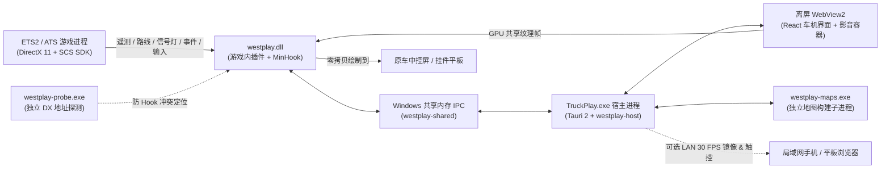

<p align="center"></p>

<h1 align="center">TruckPlay</h1>

<p align="center">
  <b>面向《欧洲卡车模拟 2》（ETS2）与《美国卡车模拟》（ATS）的 CarPlay（iOS 26 Liquid Glass）风格驾驶室智能车机屏幕。</b><br>
  An independent open-source CarPlay-style in-cabin infotainment system for ETS2 and ATS (forked from <a href="https://github.com/enes-less/WestPlay">WestPlay</a> 2.4.x under GPL-3.0-or-later).
</p>

<p align="center">
  <a href="https://github.com/juner122king/TruckPlay/releases/latest"></a>
  <a href="https://github.com/juner122king/TruckPlay/issues"></a>
  
  
  <a href="LICENSE"></a>
</p>

<p align="center">
  <a href="#features">核心特性</a> ·
  <a href="#apps">车机应用</a> ·
  <a href="#companion">伴侣与手机控屏</a> ·
  <a href="#controls">快捷键</a> ·
  <a href="#vehicles">车型与音效</a> ·
  <a href="#architecture">工作原理</a> ·
  <a href="#install">安装上手</a> ·
  <a href="#building">源码构建</a> ·
  <a href="#attribution">致谢与协议</a>
</p>

<br>

**TruckPlay** 将完整的驾驶室智能中控带入《欧洲卡车模拟 2》（ETS2）和《美国卡车模拟》（ATS）——一套程序同时支持两款游戏。它直接从你本机的游戏本体、DLC 与地图 Mod（含 ProMods 等）离线构建 3D 矢量导航地图，与游戏内部 GPS 路线深度联动，提供交通信号灯倒计时、主车道引导、固定测速提醒、货运 HUD、模拟电话/短信/行程日志、国内与国际主流影音平台、驾驶室 3D 空间扬声器音效，以及局域网手机低延迟反向触控。

<table>
  <tr>
    <td width="50%" valign="top">
      <picture>
        <source media="(prefers-color-scheme: dark)" srcset="docs/images/maps-dark.png">
        <source media="(prefers-color-scheme: light)" srcset="docs/images/maps-light.png">
        
      </picture>
      <b>本地离线高清地图与增强导航 HUD</b><br>
      直接解析本地游戏与地图 Mod，支持 3D 建筑/高架、红绿灯读秒、车道引导、测速提醒与游戏 GPS 双向联动。
    </td>
    <td width="50%" valign="top">
      <picture>
        <source media="(prefers-color-scheme: dark)" srcset="docs/images/dashboard-dark.png">
        <source media="(prefers-color-scheme: light)" srcset="docs/images/dashboard-light.png">
        
      </picture>
      <b>智能驾驶仪表盘（Dashboard）</b><br>
      导航地图、正在播放（含视频小窗）、目的地 ETA 与实时天气同屏展示，支持高速自动扩展全屏地图与明暗自动切换。
    </td>
  </tr>
</table>

> **提示**：上方配图为车机界面基础风格预览；TruckPlay 当前版本已采用 iOS 26 Liquid Glass 视觉语言，并完整集成网易云音乐、QQ 音乐、哔哩哔哩、抖音、喜马拉雅、广播电台、货运助手、电话、信息、日历、Safari 等 **17 款**车机应用。

---

<a id="features"></a>
## 核心特性 / Features

- **本地离线 3D 矢量地图与增强驾驶辅助**
  - 直接解析本机 ETS2 / ATS 游戏文件、DLC 与第三方地图 Mod（支持 ProMods、Oyuncuyusbis 等，兼容加密定义、旧版 PMD/PMG 模型及损坏资源自动容错）；
  - 还原真实高度的 **3D 高架桥、立交匝道与 3D 立体建筑/地标**，路线精准穿过收费站卡车专用道与边境检查口；
  - **实时信号灯倒计时**：通过插件直读游戏路口控制器剩余秒数，在地图路口 3 孔灯柱与左上角导航指引卡同步读秒；
  - **主车道引导与测速辅助**：多车道推荐箭头（自适应左/右舵）、固定测速相机提醒、ETS2 圆形 / ATS 矩形限速牌与超速高亮；
  - **1:1 游戏缩放距离对齐与动态视角**：指引卡片距离与游戏 GPS（城区 1:3 / 高速 1:15–1:20）严格对齐，支持速度自适应缩放、路口放大与全路线总览（15 秒无操作自动回正）；
  - **双向路线写入与 TruckersMP 联动**：车机内搜索城市或加油站/休息站/服务站/公司/渡轮等地点可直接设为目的地或添加途经点（最多 10 个，支持最快/最短/小路优先备选路线）；自动识别 TruckersMP 实际服务器与 ProMods 独立地图缓存。
- **丰富的国内与国际影音娱乐生态**
  - 原生集成 **网易云音乐、QQ 音乐、哔哩哔哩、抖音、喜马拉雅、广播电台（HLS 直播）、Apple Music、YouTube、本地音乐播放器（Player）**；
  - 全平台统一 **媒体互斥**（同一时间仅一个音源发声）、**游戏暂停/切菜单自动暂停与恢复**、以及 **30 秒闲置页面自动回收**（释放 WebView 内存并保留登录态与偏好）；
  - 接入 **驾驶室 3D 空间扬声器音频图** 与车外视角自动闷音，内置多段自定义均衡器（EQ）。
- **货运模拟与 SCS 游戏事件深度联动**
  - 通过 SCS 遥测与游戏事件桥接，在车机内提供 CarPlay Liquid Glass 风格的 **货运助手（运单/车检/工时 HOS）**、**电话（道路救援 F7 自动操作/银行/二手卡车/车队通讯录/快捷短码）**、**信息（调度/车队/交通罚单收费站通知/免打扰/快捷回复）** 与 **日历（7 天行程与 30 天驾驶收支日志）**。
- **原车屏、客车与全车型挂件平板适配**
  - 覆盖 ETS2 多款原车中控屏、Coaches DLC 官方客车（保留倒车影像置顶与点击阻断）、Oyuncuyusbis 客车共享 GPS 玻璃布局，以及 ATS 6 款官方车型原车屏；其余所有官方及 Mod 车型均可在改装店加装 **TruckPlay 挂件平板**（标准版与 1.2× 大尺寸版）。
- **局域网手机远程控屏（Mobile WebUI）**
  - 可在伴侣端一键开启（默认关闭），通过手机或平板浏览器扫码直连，以最高 30 FPS 低延迟实时镜像车机画面并进行单指触控与滑动操作。
- **高稳定性与工具共存**
  - 通过独立进程 `westplay-probe.exe` 探测 DirectX 入口，避免与 Steam Overlay、OptiScaler、Snowy Moon TAA/DLSS、RivaTuner、Trucky 等注入/覆盖工具冲突；
  - 支持 Steam 多账号识别隔离、独立 `westplay-maps` 地图构建子进程、SHA-256 增量依赖缓存校验（游戏热修复免盲目重打地图）、DLC/脚本变动自动重建屏幕 Mod 与 WebView2 启动重试保护。

---

<a id="apps"></a>
## 车机应用全景 / In-Cabin Apps

当前版本开放 **17 款** CarPlay 风格车机应用，配合智能分屏 **仪表盘（Dashboard）**、**屏内虚拟键盘** 与 **随车灯/昼夜自动切换的浅/深色外观**：

| 分类 | 应用 | 核心能力说明 |
| :--- | :--- | :--- |
| **导航与分屏** | **地图（Maps）** | 本地离线 3D 矢量地图、红绿灯实时倒计时、主车道引导、测速相机、限速牌、动态视角/路口放大、全路线总览、POI 搜索与写回游戏 GPS、TruckersMP 服务器与玩家显示 |
| **导航与分屏** | **仪表盘（Dashboard）** | 地图 + 正在播放（含视频跟随小窗）+ 目的地 ETA + 实时天气分屏卡片；车速 ≥ 30 km/h 且 30 秒无操作自动隐藏侧卡展开全屏地图（可关闭） |
| **国内音乐与音频** | **网易云音乐** | CarPlay 风格 UI，推荐、乐馆、我的音乐（含播客电台与歌手分类）、搜索、队列管理、歌词同步、真实头像昵称同步与自动连播 |
| **国内音乐与音频** | **QQ 音乐** | 推荐、乐馆榜单、电台、我的音乐、热搜与歌曲搜索、收藏/歌单、播放队列、歌词显示与独立账号登录 |
| **国内音乐与音频** | **喜马拉雅** | Liquid Glass 风格重构，首页、分类、榜单、专辑详情、我的订阅/历史、自动连播队列与主站鉴权 |
| **国内音乐与音频** | **电台（Radio）** | 全国与省市直播电台（基于 `hls.js`），支持地区/分类筛选、实时节目单与进度、收藏电台及断流自动重连保活 |
| **国内视频** | **哔哩哔哩（Bilibili）** | 精选（推荐/热门）、动态、直播、影视四大分页，车机内视频播放、原生弹幕层与开关同步、刷新分页与登录态同步 |
| **国内视频** | **抖音（Douyin）** | Liquid Glass 风格重构，推荐/精选/关注/官方频道/我的收藏与历史、H.264 直放、上下切视频、自动连播、填充/适配切换、点赞收藏与不中断播放的标签切换 |
| **国际与本地影音** | **音乐（Apple Music）** | iPadOS 26 / CarPlay 风格界面，主页、新发现、广播、资料库与搜索，支持歌词与 Now Playing |
| **国际与本地影音** | **YouTube** | 浏览频道、播放列表、搜索、观看历史、画质与字幕控制，支持仪表盘小窗视频联动 |
| **国际与本地影音** | **Player（本地播放器）** | 自动扫描并热监听游戏自带音乐目录（`Documents\<游戏名>\music`），支持列表、随机/循环播放与音频标签读取 |
| **模拟驾驶与货运** | **货运（Freight）** | Liquid Glass 三分页：**运单**（中文地名/货物重量/净收益/费率/时间缓冲）、**车检**（发动机/变速箱/驾驶室/底盘/轮胎损耗/油量续航/气压）、**工时 HOS**（驾驶环/下次休息点/超时预警） |
| **模拟驾驶与货运** | **电话（Phone）** | 不打断音乐的视觉通话与实时字幕：道路救援（自动触发游戏内 F7 拖车至维修站 / 拖车至路面 / 紧急加油）、银行、二手卡车、存档车队通讯录（自有车库/AI 司机/发收货公司）与拨号盘快捷短码（`1` 加油站 / `2` 休息站 / `3` 服务站 / `0` 总部） |
| **模拟驾驶与货运** | **信息（Messages）** | 接收 SCS 游戏事件桥接消息（调度、车队、交通罚单/收费站/渡轮/火车、联机车队），支持免打扰（默认开启）、快捷回复、一键添加沿途停靠点卡片与全局驾驶提醒横幅 |
| **模拟驾驶与货运** | **日历（Calendar）** | 动态游戏日期图标、周一至周日 7 天行程条、任务/工时/保养日程规划（支持一键添加沿途休息或维修点）及持久化 30 天驾驶收支日志 |
| **工具与系统** | **Safari** | iPadOS 26 风格车载浏览器，独立/紧凑标签栏、页面顶部取色、多搜索引擎（Google / Yahoo / Bing / DuckDuckGo / Ecosia）、移动版排版、历史清理与车内扬声器发声 |
| **工具与系统** | **天气 & 设置** | 实时动态昼夜/雨景天气与路面状况；车机设置支持明暗外观、亮度滑块、壁纸、仪表盘小组件、多段自定义 EQ、文字大小、24 小时制时钟、动态导航参数与 Safari 配置 |

---

<a id="companion"></a>
## 桌面伴侣与局域网手机控屏 / Companion & Mobile WebUI

### Companion 桌面伴侣应用（`TruckPlay.exe`）

基于 Tauri 2 构建的无边框透明玻璃态桌面管理端，提供交互式首次安装向导与 **8 大管理模块**：

1. **车机屏幕（Truck Screen）**：切换车机/原厂屏显示、监控引擎连接与实时帧率、多显卡环境指定渲染 GPU、客车驾驶座/全车乘客区扬声器切换。
2. **控制（Controls）**：自定义车机交互键、切换按住（Hold）或开关（Toggle）模式、调节指针灵敏度、控制原车状态条显隐、配置全部快捷键。
3. **自定义（Customize）**：切换内置或导入个人壁纸（支持浅/深色配对），导入第三方图标包（文件夹或 `.zip`）并选择图标浅/深色风格。
4. **账号（Accounts）**：统一管理 YouTube、网易云音乐、QQ 音乐、哔哩哔哩、喜马拉雅、抖音、Apple Music 的本地 WebView2 独立登录状态。
5. **地图（Map）**：按游戏与游戏档案（含 TruckersMP / ProMods）精细控制自动维护开关（**默认关闭**，避免意外占满资源）、一次性手动准备/强制重建、按任务 ID 取消、3D 建筑/3D 道路开关，以及面向高配主机的全核「加速准备地图」模式。
6. **选项（Options）**：设置启动时最小化、关闭/最小化时驻留系统托盘，支持单实例二次启动自动唤醒。
7. **安装与设置（Setup）**：自动检测并校验本机 ETS2 / ATS 目录、插件与屏幕 Mod 状态、一键重装/卸载、切换界面语言（简体中文 / English）、开启局域网手机控屏。
8. **关于（About）**：查看当前版本、自动检查并签名安装 GitHub Releases 更新、查看 GPU/WebView2/日志路径实时诊断信息并一键复制排错报告。

### 局域网手机远程控屏（Mobile WebUI）

- **默认关闭**，可在 Companion **「设置（Setup）」** 页一键开启；
- 开启后自动监听本机局域网端口（`8765`），页面直接生成**配对二维码**与可复制的局域网 URL；
- 同一 Wi-Fi / 局域网下的手机或平板浏览器扫码即可打开，以最高 **30 FPS（1280×720 双缓冲 GPU 读回 MJPEG）** 实时镜像驾驶室屏幕，支持单指点击、拖拽与滑动反向操控车机，无需额外安装手机 App。

---

<a id="controls"></a>
## 操作方式与默认快捷键 / Controls & Keybinds

在驾驶室中，按住（或按一下切换）交互键即可用鼠标移动车机屏内指针并点击/拖拽操作；所有快捷键均可在 Companion **「控制」** 页自由修改为任意键盘按键或鼠标侧键，且在按键按下期间自动屏蔽游戏（含 DirectInput）对该按键的误触发：

| 功能 | 默认快捷键 | 说明 |
| :--- | :--- | :--- |
| 唤醒 / 操作车机屏幕 | `Left Alt` | 默认按住（Hold）模式，可在 Companion 切换为单按开关（Toggle）模式 |
| 音量减 / 上一首 | `Alt + 1` | 短按调低媒体音量；**长按 1 秒**切换至上一首 |
| 播放 / 暂停 | `Alt + 2` | 控制当前活跃音乐/视频/电台应用的播放与暂停 |
| 音量加 / 下一首 | `Alt + 3` | 短按调高媒体音量；**长按 1 秒**切换至下一首 |
| 降低屏幕亮度 | `Alt + 4` | 步进降低车机屏幕整体亮度（屏幕顶部显示亮度 HUD） |
| 提高屏幕亮度 | `Alt + 5` | 步进提高车机屏幕整体亮度 |

---

<a id="vehicles"></a>
## 适配车型、挂件平板与 3D 驾驶室音效 / Vehicles & Cabin Audio

TruckPlay 以两种形态呈现在驾驶室内：**原车中控屏幕** 与 **通用车机挂件平板**。

| 对比项 | 原车中控屏幕 | TruckPlay 挂件平板（含 1.2× 大尺寸版） |
| :--- | :--- | :--- |
| 适用范围 | 下方列出的 ETS2 / ATS 原生适配车型与客车 | 所有其余官方与第三方 Mod 车型（ETS2 & ATS 通用） |
| 启用方式 | 无需改装，进入驾驶室直接生效 | 在改装店「内饰配件 → 挂件（Hanging Items）」或「中控台套装（Dashboard Set）」加装 |
| 游戏原 GPS | 由 TruckPlay 接管（可通过侧栏卡车图标或伴侣端随时切回） | 原车屏幕继续保留游戏自带 GPS |

### 原车中控屏幕已适配列表

- **Euro Truck Simulator 2（ETS2）**
  - **DAF**：XF / XG / XG+ (2021)、XF Electric、XD（含 Jasper's DAF 2021 Mod）
  - **Scania**：S & R（7" 原厂屏与 Smart Dash 10.1" / 12.9" Advanced）、S BEV
  - **Iveco**：S-Way
  - **Renault**：T (2024)
  - **Volvo**：FH (2021 / 2024)
  - **Coaches DLC 官方客车**：Scania Touring、MAN Lion's Coach (2024)（保留原生倒车影像置顶与显示期间输入阻断；Volvo 9700 可在中控台加装挂件平板）
  - **Oyuncuyusbis 客车 Mod**：Mercedes-Benz Travego 16 SHD、MAN Lion's Coach、Setra S 516 HD/2、Setra S 531 DT（基于共享 GPS 玻璃子矩形 `ob-gps` 精准映射）
- **American Truck Simulator（ATS）**
  - **Road Trip 官方车型**：Ford F-150 (2023)、Ford Bronco (2024)（Bronco 保留原生倒车影像优先权与点击阻断）
  - **美卡原车屏**：Volvo VNL (2025)、Freightliner Cascadia (2024 Digital Dash)、Kenworth T680 (2022)、Western Star 57X

### 驾驶室 3D 空间扬声器音效

所有音视频平台及车载 Safari 浏览器均接入车内空间声场渲染：依据真实驾驶室物理扬声器位置（门板低音、A 柱高音、顶棚低音/中置、后墙低音等）与分频点发声，视角切至车外时自动呈现闷音效果；**Coaches DLC 客车** 还支持在 Companion 中切换 **「驾驶座扬声器」** 或 **「全车乘客区扬声器」**。其余车型与 ATS 车型播放标准立体声。

<details>
<summary><b>展开查看全部支持 3D 空间扬声器布局的车型清单（20+ ETS2 车型与客车）</b></summary>

- **Scania S / R (2016)、S BEV**：车门低音 + A 柱高音 + 顶棚低音
- **Scania R (2009)、Streamline**：车门低音 + A 柱高音
- **JuseeTV's Scania PGR**：按所装配内饰部件自适应（车门、A 柱、顶部中控台、后墙）
- **DAF XF (105)**：A 柱高音 + 顶置储物架双对（Super Space Cab）或单顶置单元
- **DAF XF Euro 6**：车门低音 + A 柱高音 + 顶置单元
- **DAF XF / XG / XG+ (2021)、XF Electric、XD**：车门中低音 + A 柱高音 + 顶棚前角中音 + 中置补声
- **MAN TGX / TGX Euro 6**：车门低音 + 高顶侧墙/顶角辅助单元
- **MAN TGX (2020)**：车门低音与中音 + A 柱高音
- **Mercedes-Benz Actros (2014)**：车门低音 + 顶置单元 + A 柱高音
- **Mercedes-Benz Actros (2009)**：车门低音 + 顶置前角单元
- **Volvo FH (2021 / 2024)、FH16 (2012)**：车门低音 + 后墙低音
- **Volvo FH16 (2009)**：双侧车门单元
- **Iveco Stralis / Hi-Way**：顶置中控两端单元 + 高顶侧部辅助单元
- **Iveco S-Way**：双侧车门低音 + 高音
- **Renault Magnum / Premium**：顶角/车顶两侧单元（Magnum 含顶置中控高音）
- **Renault T / E-Tech T**：A 柱高音 + 后墙单元（2024 内饰与 E-Tech T 含车门低音）
- **Coaches DLC 客车**：MAN Lion's Coach (2024，双轴/三轴)、Scania Touring（双轴/三轴）、Volvo 9700（支持驾驶座 / 全车乘客区扬声器模式切换）

</details>

---

<a id="architecture"></a>
## 工作原理与项目架构 / Architecture



### 工作区目录结构

| 路径 | Crate / 包名 | 职责说明 |
| :--- | :--- | :--- |
| `app/` | `westplay-app` (`TruckPlay.exe`) | Tauri 2 桌面入口，承载透明玻璃态 Companion 窗口、系统托盘、单实例唤醒与签名自动更新 |
| `crates/plugin/` | `westplay-plugin` (`westplay.dll`) | SCS Telemetry SDK 游戏插件：D3D11/DXGI 画面注入、DirectInput/Win32 输入拦截、信号灯/路线内存读取与模拟按键动作引擎 |
| `crates/probe/` | `westplay-probe` (`westplay-probe.exe`) | 游戏进程外 DirectX 函数地址探测工具，避免与 Steam Overlay、OptiScaler、RivaTuner 等覆盖层冲突 |
| `crates/shared/` | `westplay-shared` | 插件与宿主间的跨进程共享内存数据结构定义、`screen_layouts.txt` 屏幕布局表与崩溃辅助 |
| `crates/host/` | `westplay-host` | 离屏 WebView2 宿主、GPU 帧采集管道、各流媒体控制器与 30 秒闲置回收、3D 驾驶室音频图、LAN Mobile WebUI 与路线规划 |
| `crates/mapdata/` | `westplay-mapdata` | SCS HashFS 归档读取、CityHash64、GDeflate 纹理与旧版 PMD/PMG 解码、车道引导/测速相机/3D 建筑/海域瓦片提取及 SHA-256 依赖追踪 |
| `crates/maps/` | `westplay-maps` (`westplay-maps.exe`) | 独立地图构建子进程（采用 `mimalloc` 分配器），实现与主进程隔离的崩溃与内存管理 |
| `crates/setup/` | `westplay-setup` | Steam 库/独立游戏发现、DLC 与多档案扫描、插件部署、屏幕 Mod（`westplay.scs`）与平板 3D 配件生成 |
| `ui/` | `westplay-ui` | React 19 + TypeScript + Vite 8 + Zustand 5 + MapLibre GL JS 5 前端工程，包含车机端（`src/cabin`）与伴侣端（`src/companion`） |
| `tools/` | 构建与发布脚本 | 插件交叉编译（`build_plugin.py`）、资源构建（`build_resources.ps1`）、签名打包与自动发布脚本（`release.ps1` / `release_lib.py`） |

### 深入技术文档

- [交通信号灯与实时倒计时架构文档](docs/traffic_lights_architecture.md)
- [导航 UI、车道引导与路线总览设计](docs/navigation-guidance.md)
- [地图按需处理与 SHA-256 依赖校验](docs/map-preparation.md)
- [运行资源回收机制与内存验收记录](docs/runtime-resource-optimization.md)
- [发布签名与自动更新工作流](docs/release-workflow.md)
- [版本变更日志（CHANGELOG）](CHANGELOG.md)

---

<a id="install"></a>
## 安装与快速上手 / Install & Quick Start

### 运行环境要求

- **操作系统**：Windows 10 / 11（64-bit）
- **运行库**：Microsoft Edge WebView2 Runtime（Windows 11 默认内置，缺失时安装包会自动补全）
- **支持游戏**：《欧洲卡车模拟 2》（已测 `1.61` / `1.62`）或《美国卡车模拟》（已测 `1.62`；其他邻近版本亦可通过特征码兼容，伴侣端会提示是否经过完整测试）

### 安装步骤

1. 前往 [GitHub Releases](https://github.com/juner122king/TruckPlay/releases/latest) 下载最新的 Windows 安装包（`TruckPlay_*_x64-setup.exe`）并运行安装。
2. 启动 **TruckPlay** 伴侣应用，按照引导自动扫描本机 ETS2 / ATS 安装目录并安装驱动插件（`westplay.dll` + `westplay-probe.exe`）及屏幕 Mod（`westplay.scs`）。
3. 前往伴侣端 **「地图（Map）」** 页面，开启所需游戏与档案的维护开关或点击 **「准备一次」**，离线构建对应地图缓存（构建期间请保持游戏关闭）。
4. 正常启动游戏并进入驾驶室即可使用（原车屏车型自动生效，其余车型请先在改装店加装 TruckPlay 平板）。

> **平滑升级说明**：从 WestPlay 或国内定制版升级至 TruckPlay 时，既有游戏档案配置、本地地图缓存与插件路径均保持兼容，无需手动清理或重新配置。

---

## 常见问题与排错 / FAQ & Troubleshooting

- **为什么进入游戏后无法设置路线或伴侣端提示权限问题？**
  请**不要以管理员身份运行** ETS2 / ATS。若游戏以管理员权限启动而 TruckPlay 以普通权限运行，Windows UIPI 会阻断跨进程通信与路线读取。
- **为什么安装完成后地图没有自动开始生成？**
  为避免后台意外占用 CPU 与内存，游戏与档案的自动地图维护开关默认关闭。请前往伴侣端 **「地图（Map）」** 页面按需手动点击「准备一次」或开启对应档案的自动维护开关。
- **如何排查崩溃或异常并提交 Issue？**
  - 插件日志：`Documents\WestPlay\logs\plugin.log`
  - 宿主日志：`Documents\WestPlay\logs\app.log`（上一次运行日志保留为 `app.old.log`；若 `Documents` 受权限/勒索防护限制，则自动回退保存至 `%LOCALAPPDATA%\io.github.juner122king.truckplay`）
  - 你也可以在伴侣端 **「关于（About）」** 页面点击一键复制不含账号隐私的诊断报告，连同日志一起提交至 [GitHub Issues](https://github.com/juner122king/TruckPlay/issues)。

---

<a id="building"></a>
## 从源码构建 / Building from Source

### 前置依赖（Windows 10 / 11 64-bit）

- [Rust](https://rustup.rs)（stable 工具链，并安装插件交叉编译目标：`rustup target add x86_64-pc-windows-gnullvm`）
- **LLVM-MinGW** 工具链（用于编译游戏内 `westplay.dll` 与 `mimalloc`）：通过环境变量 `WESTPLAY_LLVM_MINGW` 指定路径，或直接解压至默认路径 `target/toolchains/llvm-mingw-20260602-ucrt-x86_64`
- [Node.js](https://nodejs.org) 24+ 与 Python 3

### 开发与构建命令

```powershell
# 1. 安装根目录 Tauri CLI 与 ui/ 前端依赖
npm install

# 2. 启动开发调试模式（含 Vite 热重载与 Tauri 伴侣端）
npm run dev

# 3. 仅编译构建资源（westplay-maps.exe、westplay-probe.exe、westplay.dll，不触碰本机游戏目录）
npm run build:resources

# 4. 构建完整桌面端 / 发布安装包
npm run build
npm run build:release         # 使用 app/tauri.release.conf.json 打包 NSIS 安装程序
npm run release:dry           # 本地完整演练构建、签名与清单校验（不推送远端）
```

### 自动化测试与代码检查

```powershell
# 配置当前会话的 LLVM-MinGW 工具链（如未全局设置）
$env:WESTPLAY_LLVM_MINGW = (Resolve-Path target/toolchains/llvm-mingw-20260602-ucrt-x86_64).Path
$env:CC = Join-Path $env:WESTPLAY_LLVM_MINGW 'bin/clang.exe'
$env:AR = Join-Path $env:WESTPLAY_LLVM_MINGW 'bin/llvm-ar.exe'

cargo test --workspace --locked                # Rust 工作区测试
python -m unittest discover -s tools/tests -v  # 构建与发布脚本测试
python tools/build_plugin.py                   # 单独编译游戏插件 DLL（不部署到游戏）
npm --prefix ui test                           # 前端 Vitest 单元测试
npm --prefix ui run lint                       # 前端 Oxlint 代码检查
npm --prefix ui run build                      # TypeScript 类型检查 + Vite 生产构建
```

---

## 隐私与安全说明 / Privacy & Security

TruckPlay 坚持零遥测、本地优先原则：

- **无中心化统计或账号采集服务器**：不收集、不上报任何用户使用行为或游戏存档数据；
- **地图完全本地构建**：全部地图瓦片与路径索引均在你的电脑上直接由本地游戏与 Mod 文件生成；
- **流媒体账号本地隔离**：所有音乐与视频平台均在其官方网页环境下登录，凭证仅保存于本机独立的 WebView2 用户目录；
- **签名更新校验**：仅在检查软件更新时访问 GitHub Releases，并通过内置 Minisign 公钥严格验证安装包签名与版本号；
- **局域网控屏默认关闭**：Mobile WebUI 仅在你主动开启后监听本地局域网，不经由任何公网中转。

---

<a id="attribution"></a>
## 源项目致谢与开源协议 / Attribution & License

### 上游源项目与社区致谢

TruckPlay 基于优秀开源项目 **[WestPlay](https://github.com/enes-less/WestPlay)**（原作者 **enes-less**，2.4.0 / 2.4.1，`GPL-3.0-or-later`）分支独立延续开发与维护，完整保留所有上游贡献者的版权声明与 Git 提交历史。谨向 **enes-less** 及所有 WestPlay 上游贡献者致以诚挚感谢！

同时保留并致谢原项目所依赖与借鉴的开源项目及社区创作者（完整版权与许可原文见 [THIRD_PARTY_NOTICES.md](THIRD_PARTY_NOTICES.md) 与 [assets/tablet/README.md](assets/tablet/README.md)）：

- **[ts-map](https://github.com/dariowouters/ts-map)**（Dario Wouters，MIT）：SCS 二进制地图文件与 HashFS 归档格式读取参考；
- **[MapLibre GL JS](https://github.com/maplibre/maplibre-gl-js)**（BSD-3-Clause）：车机矢量地图与 3D 渲染引擎；
- **[CityHash](https://github.com/google/cityhash)**（Google，MIT）：游戏归档条目路径 CityHash64 算法实现参考；
- **[GDeflate / NVIDIA libdeflate / DirectStorage](https://github.com/NVIDIA/libdeflate)**（MIT / Apache-2.0）：SCS 归档纹理 GDeflate 压缩解码参考；
- **[hls.js](https://github.com/video-dev/hls.js)**（Apache-2.0）：直播电台 HLS 流媒体播放引擎；
- **Art_bor**（[Ipad Air 5 (FREE)](https://sketchfab.com/3d-models/ipad-air-5-free-628ab0359d774af480be8eda9de70272)，[CC BY 4.0](https://creativecommons.org/licenses/by/4.0/)）与 **Kedi739**（平板 Mod 描述符结构使用授权）：车机挂件平板 3D 模型基础；
- **SCS Software Telemetry SDK 1.15**：游戏内遥测数据接口。

### 开源协议 / License

TruckPlay 是自由软件：你可以按照 **GNU General Public License v3.0 or later（GPL-3.0-or-later）** 的条款对其进行重新分发和修改，详见 [LICENSE](LICENSE)。

- 随项目分发或依赖的第三方开源库均保留其各自原始协议，完整清单见 [THIRD_PARTY_LICENSES.md](THIRD_PARTY_LICENSES.md)；
- 算法借鉴、协议声明与 3D 模型署名详见 [THIRD_PARTY_NOTICES.md](THIRD_PARTY_NOTICES.md)。

---

<sub>
免责声明：TruckPlay 为独立开源项目，与 SCS Software、Apple、Google、网易、腾讯、哔哩哔哩、喜马拉雅、字节跳动（抖音）或任何卡车/客车制造商均无隶属或背书关系。文中提及的所有品牌名称与商标均归其各自所有者所有，仅用于说明兼容性。<br>
TruckPlay is an independent open-source project, not affiliated with or endorsed by SCS Software, Apple, Google, NetEase, Tencent, Bilibili, Ximalaya, ByteDance (Douyin), or any truck/coach manufacturer. All trademarks belong to their respective owners and are used solely to describe compatibility.
</sub>
