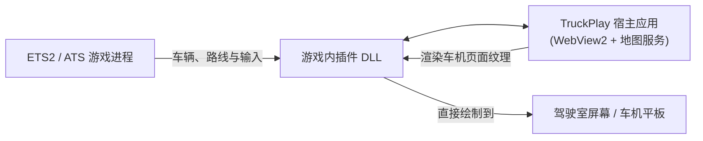

<p align="center"></p>

<h1 align="center">TruckPlay</h1>

<p align="center">
  <b>面向 Euro Truck Simulator 2 与 American Truck Simulator 的 CarPlay 风格驾驶室车机屏幕。</b><br>
  An independent open-source CarPlay-style in-cabin screen for ETS2 and ATS (forked from WestPlay 2.4.x under GPL-3.0-or-later).
</p>

<p align="center">
  <a href="https://github.com/juner122king/TruckPlay/releases/latest"></a>
  <a href="https://github.com/juner122king/TruckPlay/issues"></a>
  
  
  <a href="LICENSE"></a>
</p>

<picture>
  <source media="(prefers-color-scheme: dark)" srcset="docs/images/home-dark.png">
  <source media="(prefers-color-scheme: light)" srcset="docs/images/home-light.png">
  
</picture>

**TruckPlay** 将完整的驾驶室智能中控带入《欧洲卡车模拟 2》（ETS2）和《美国卡车模拟》（ATS）：直接从你的本地游戏文件与 Mod（含 ProMods 等）离线构建高清导航地图，与游戏内部 GPS 路线联动，并内置国内影音、货运 HUD、测速与红绿灯辅助以及手机局域网遥控。

---

## 核心特性 / Features

- **本地离线地图与增强导航 HUD**：直接解析你的游戏与地图 Mod，支持路口放大、主车道引导箭头、固定测速相机提示、HUD 信号灯倒计时与速度动态视角；搜索目的地可直接写入游戏导航路径点。
- **双卡货运信息（Freight HUD）**：在车机内查看当前接单与挂车货运进度、距离及收益状态。
- **国内与国际影音娱乐**：集成 **网易云音乐**、**Bilibili**、**广播电台（HLS 直播）**，以及 Apple Music、YouTube 与本地音乐播放器，支持车内空间扬声器声道布局与浅/深色自动切换。
- **局域网手机远程控屏（Mobile WebUI）**：可在 Companion 设置页一键开启（默认关闭），通过局域网浏览器以低延迟镜像驾驶室画面并进行单指触控/滑动操作。
- **原车屏、挂件平板与客车适配**：
  - **ETS2**：适配 DAF 2021、Scania 2016/2025/Smart Dash、Iveco S-Way、Renault T 2024、Volvo FH 2021/2024、Coaches DLC（Scania Touring / MAN Lion's Coach 2024），以及 Oyuncuyusbis 大巴共享 GPS 玻璃布局；其余卡车或 Mod 车型支持在改装店挂载车机平板（含大尺寸平板选项）。
  - **ATS**：适配 Ford F-150 (2023) / Bronco (2024)（保留原生倒车影像优先权）、Volvo VNL (2025)、Freightliner Cascadia (2024)、Kenworth T680 (2022)、Western Star 57X 等原屏与平板挂件。
- **稳定性与多账号支持**：支持 Steam 多账号登录隔离、游戏增量依赖缓存校验（热修复免盲目重打地图）、DLC/脚本变动自动重建屏幕 Mod，以及 WebView2 启动重试保护。

---

## 工作原理 / How it works



---

## 安装与使用 / Install

1. 前往 [Releases](https://github.com/juner122king/TruckPlay/releases/latest) 下载最新的 Windows 安装包（`TruckPlay_*_x64-setup.exe`）并运行。
2. 伴侣应用（Companion）会自动识别本机已安装的 ETS2 / ATS，安装驱动插件与屏幕 Mod，并按需离线生成对应档案的地图资源。
3. 进入游戏驾驶室即可使用（默认使用鼠标配合按键触发屏内指针，也可开启手机端 Mobile WebUI 触控）。

**运行环境**：Windows 10 / 11 (64-bit)，Microsoft Edge WebView2 Runtime。

---

## 从源码构建 / Building from Source

前置依赖：
- Windows 10 / 11 (64-bit)
- [Rust](https://rustup.rs) 工具链与 LLVM-MinGW 工具链（用于编译游戏内 DLL，可通过 `WESTPLAY_LLVM_MINGW` 指定或置于 `target/toolchains/llvm-mingw-20260602-ucrt-x86_64`）
- [Node.js](https://nodejs.org) 24+ 与 Python 3

```powershell
npm install                   # 安装 Tauri CLI 与 ui 前端依赖
npm run dev                   # 启动开发调试模式
```

常用校验与构建命令：

```powershell
cargo test --workspace --locked
python -m unittest discover -s tools/tests -v
python tools/build_plugin.py
npm --prefix ui test -- --run
npm --prefix ui run lint
npm --prefix ui run build
```

---

## 隐私说明 / Privacy

TruckPlay 不包含中心化统计或账号采集服务器：
- 地图数据完全在本地由你的游戏与 Mod 文件生成；
- 音乐/视频账号均通过各自官方网页环境在本地 WebView2 配置目录中独立登录；
- 仅在你检查软件更新时访问 GitHub Releases（通过公钥签名校验）。

---

## 开源协议与致谢 / License & Attribution

TruckPlay 基于原开源项目 **WestPlay**（2.4.x，GPL-3.0）分支独立延续维护，完整保留所有上游贡献者版权与提交历史。

- 本项目遵循 **GNU General Public License v3.0 or later** 发布，详见 [LICENSE](LICENSE)。
- 内置第三方库与开源组件许可声明见 [THIRD_PARTY_LICENSES.md](THIRD_PARTY_LICENSES.md) 与 [THIRD_PARTY_NOTICES.md](THIRD_PARTY_NOTICES.md)。

<sub>TruckPlay is an independent open-source project, not affiliated with or endorsed by SCS Software, Apple, Google, NetEase, Bilibili, or any truck manufacturer. All trademarks belong to their respective owners.</sub>
